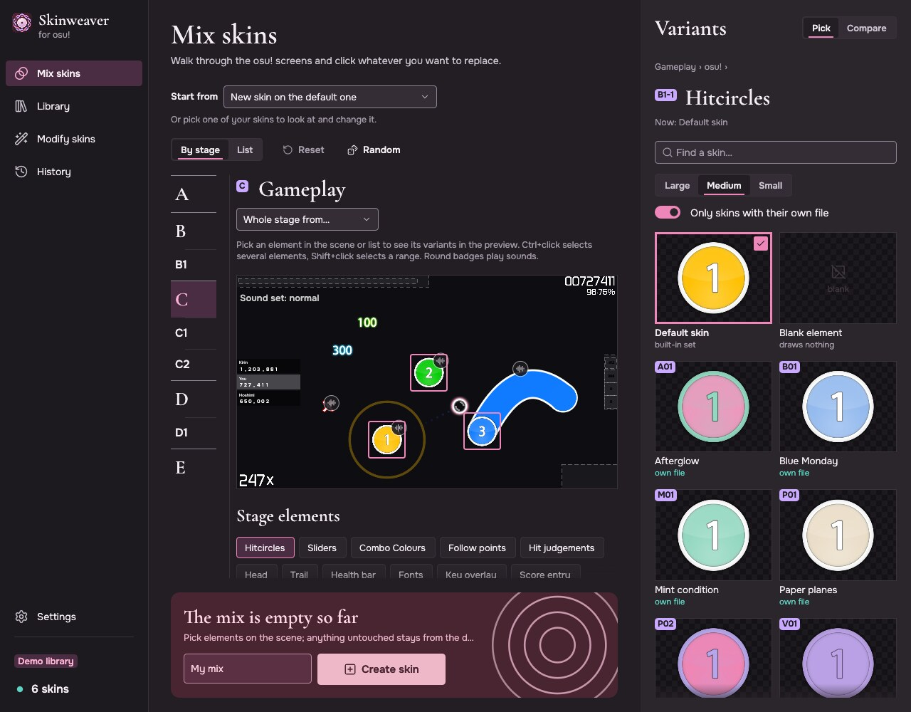
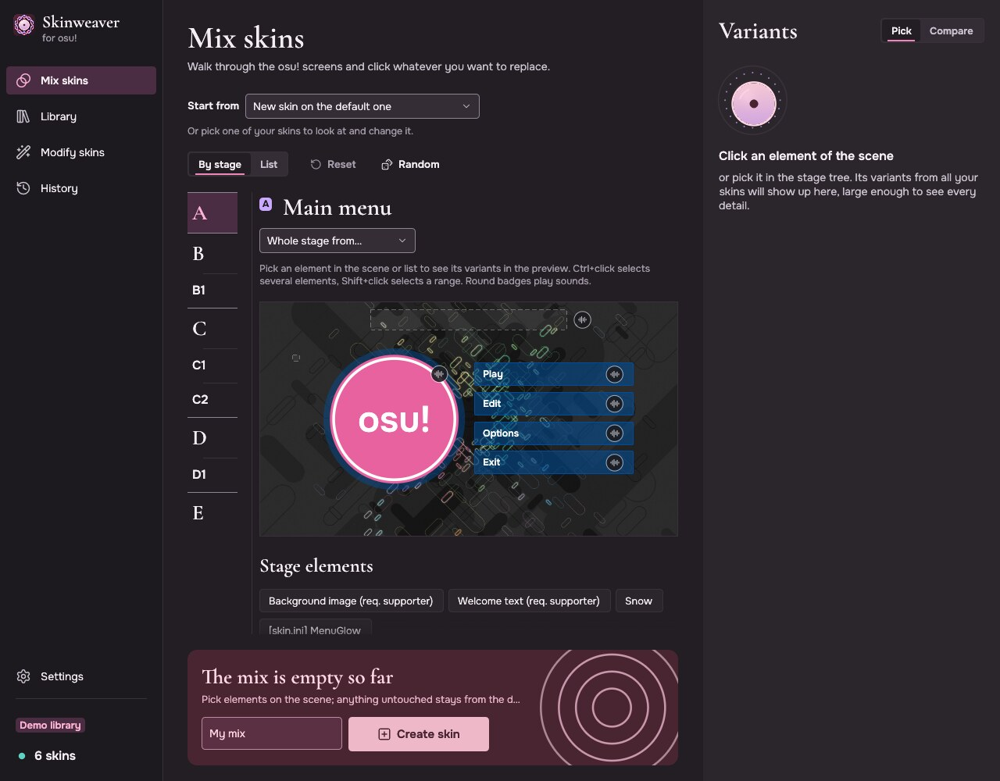
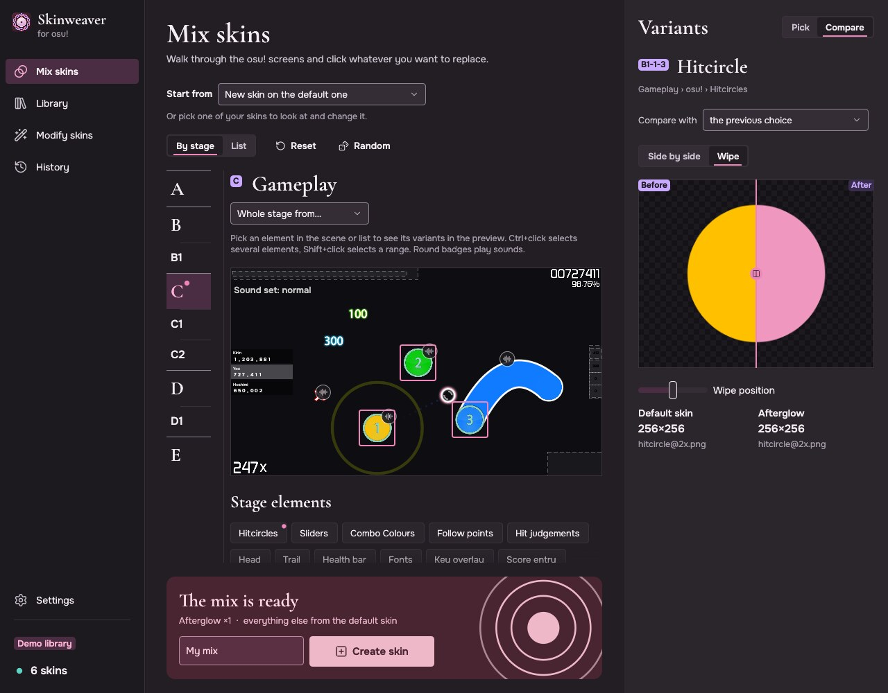
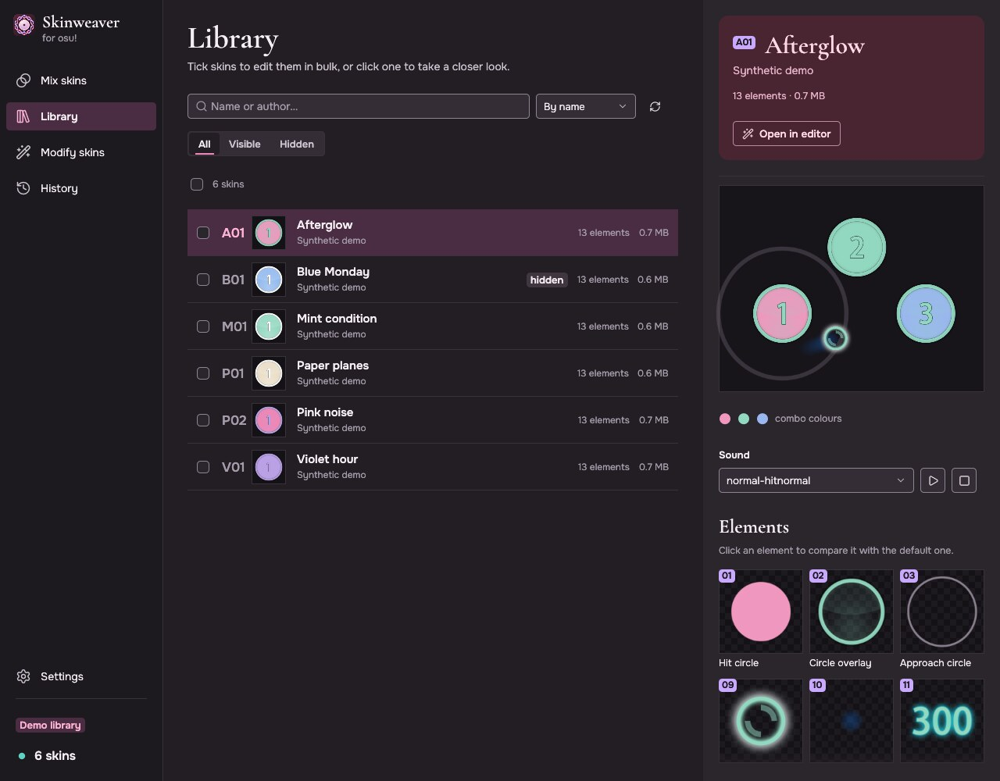

# Skinweaver

Build new osu! skins from the elements of the skins you already have, screen by screen,
with a live preview. A Windows app written in Rust + egui.

**Version 1.0.0 · Windows x64 · English and Russian UI**

[Download](https://github.com/himawari17/Skinweaver/releases) · [Report a bug](https://github.com/himawari17/Skinweaver/issues) · [Русский](#русский)



Grew out of [osu! Skin Mixer](https://github.com/rednir/OsuSkinMixer) by rednir: rewritten in Rust and substantially extended.

## Features

**Mix by stage.** A skin is put together screen by screen, in the order a player sees them:
main menu → song select → gameplay → pause → results. Each stage is a scene drawn from what is picked right now.
Click any element of the scene and its variants from all your skins show up in the preview as large tiles.

- Groups (hit circles, sliders, fonts…) are shown whole, in their skin's combo colours, and part by part.
- Sounds play right from the scene; gameplay offers the Normal / Soft / Drum hitsound sets.
- "Whole stage from…" takes an entire screen from one skin, "Random" builds a random skin.
- Start from the default skin or any of your own. Save the result as a copy or straight into the skin.
- The classic list view is still there.



**Before / after comparison.** Side by side or with a wipe, at one scale, with sizes and animation frames;
compare with the previous pick, the default skin or any other skin. The wipe can be moved with a slider,
keyboard included.



**Batch edits.** Replace elements and apply tweaks (smooth cursor trail, instafade and more)
to several skins at once. Everything can be undone, even after a restart.

**Library.** Search, sorting, hidden skins, and a scene and element gallery for every skin.
Opens instantly from cache and refreshes quietly in the background; new skins are picked up on their own.
Copy, rename, delete and export to `.osk`.



## Installation

1. Download `skinweaver-windows-x64.zip` from [Releases](https://github.com/himawari17/Skinweaver/releases).
2. Extract it and run `skinweaver.exe` - no installer and no Rust needed.
3. On first start, select your osu! folder that contains `Skins`
   (usually `%LOCALAPPDATA%\osu!` or `D:\Games\osu!`).

Folder-based osu! (stable) skins are supported. Direct import from osu!lazer's internal library is not available.

To try it out, run in PowerShell from the extracted folder:

```powershell
.\skinweaver.exe --demo
```

The demo uses a temporary library and temporary settings and never touches your skins.

The interface language follows Windows on first start (English or Russian); change it in Settings or with `--lang en|ru`.

- Settings and cache live in `%APPDATA%\Skinweaver` (an old `osu-skin-mixer-rust` folder is moved there on first start).
- Backups for undo live in `.osu-skin-mixer-backups` next to `Skins` (the old name is kept so earlier undos keep working); they are never deleted automatically.
- History is stored with the backups. If skin files are changed outside the app after an operation, undo may refuse to overwrite them.

## Controls

| Action | Shortcut |
| --- | --- |
| Find a skin or element in the current section | `Ctrl+F` |
| Rescan the library | `F5` |
| Add an element to the selection | `Ctrl+click` |
| Select a range of list elements | `Shift+click` |
| Clear the selection / close a dialog | `Esc` |
| Create the skin from the mix form | `Ctrl+Enter` |
| Move between controls | `Tab` / `Shift+Tab` |

## Building from source

Requires Windows x64, Rust stable 1.95+ (`x86_64-pc-windows-msvc`) and Visual Studio Build Tools
(Desktop development with C++ and the Windows SDK).

```powershell
git clone https://github.com/himawari17/Skinweaver.git
cd Skinweaver

cargo run --locked --release -- --demo                  # temporary demo library
cargo test --locked --release
powershell -NoProfile -ExecutionPolicy Bypass -File .\build.ps1
```

Or just double-click `build.bat`. The script stops if tests or the build fail.
The result is `dist\skinweaver.exe` and `dist\skinweaver-windows-x64.zip` with the README, screenshots,
documentation and license texts. To build only the app: `cargo build --locked --release --bin skinweaver`.

Arguments: `--demo`, `--lang en|ru`, `--osu-dir "D:\Games\osu!"`.

Benchmarks on your own library:

```powershell
cargo run --locked --release --example bench_scan -- "$env:LOCALAPPDATA\osu!"   # library scan
cargo run --locked --release --example bench_mix                                 # mixing on a synthetic library
```

<details>
<summary>Code layout</summary>

| File | Contents |
| --- | --- |
| `src/library.rs` | library, parallel scan and cache, history and undo |
| `src/mixer.rs`, `src/modify.rs` | building a mix, batch edits |
| `src/catalog.rs`, `data/catalog.json` | the 333 skin elements and their groups |
| `src/ui/mod.rs` | window, navigation, background jobs, dialogs |
| `src/ui/editor.rs` | element tree and source picking |
| `src/ui/stages.rs` | stages, their elements and sounds |
| `src/ui/scenes.rs` | clickable stage scenes |
| `src/ui/stage_view.rs` | stage tree, sound strip, variants panel |
| `src/ui/preview.rs` | before / after comparison, skin scene and gallery |
| `src/ui/pages.rs` | library, history, settings, first start |
| `src/ui/textures.rs` | background image loading |
| `src/ui/theme.rs` | design tokens and hand-drawn components |
| `src/ui/motion.rs` | animations |

Translation glossary: [LOCALIZATION.md](LOCALIZATION.md).
</details>

## Feedback

Bugs and suggestions go to [Issues](https://github.com/himawari17/Skinweaver/issues).
Include the app version, steps to reproduce and the expected result;
attach a screenshot of the window if it helps. The "Report a problem" button in Settings opens the same page.

## Licenses

- Code - [MIT](LICENSE). Based on [osu! Skin Mixer](https://github.com/rednir/OsuSkinMixer) © 2025 rednir (MIT).
- The bundled default osu! skin is © ppy Pty Ltd under [CC BY-NC 4.0](https://creativecommons.org/licenses/by-nc/4.0/):
  builds that include it are for non-commercial use only.
- Fonts - SIL OFL 1.1, Lucide icons - ISC, dependencies - see [THIRD_PARTY_LICENSES.txt](THIRD_PARTY_LICENSES.txt).
  Details in [ASSETS.md](ASSETS.md).

This is an unofficial fan project, not affiliated with or endorsed by ppy Pty Ltd.
"osu!" is a trademark of ppy Pty Ltd.

---

## Русский

Собирай новые скины osu! из уже имеющихся, экран за экраном, с живым предпросмотром.
Приложение для Windows на Rust + egui. Интерфейс на русском и английском.

Вырос из [osu! Skin Mixer](https://github.com/rednir/OsuSkinMixer) от rednir: переписан на Rust и сильно доработан.

### Возможности

**Сборка по этапам.** Скин собирается по экранам osu! в том порядке, в каком их видит игрок:
главное меню → выбор карты → геймплей → пауза → результаты. Каждый этап - сцена из того, что выбрано сейчас.
Нажми на элемент сцены - в предпросмотре появятся его варианты из всех твоих скинов крупными плитками.

- Группы (круги, слайдеры, шрифты…) показываются целиком, в цветах комбо своего скина, и по частям.
- Звуки проигрываются прямо со сцены; на геймплее есть наборы хитсаундов Normal / Soft / Drum.
- «Весь этап из…» берёт целый экран из одного скина, «Случайно» собирает случайный скин.
- Основой может быть стандартный скин или любой свой. Результат сохраняется копией
  или прямо в скин.
- Прежний вид списком тоже остался.

**Сравнение «Было / Станет».** Рядом или шторкой, в одном масштабе, с размерами и кадрами
анимации; сравнить можно с прошлым выбором, со стандартным скином или с любым другим.
Положение шторки можно менять ползунком, в том числе с клавиатуры.


**Пакетные правки.** Замени элементы и включи правки (плавный след курсора, instafade и др.)
сразу в нескольких скинах. Всё можно отменить - в том числе после перезапуска.

**Библиотека.** Поиск, сортировка, скрытые скины, у каждого скина - сцена и галерея элементов.
Открывается сразу из кэша и тихо обновляется в фоне; новые скины замечаются сами.
Есть копирование, переименование, удаление и экспорт в `.osk`.


### Установка

1. Скачай `skinweaver-windows-x64.zip` со страницы [Releases](https://github.com/himawari17/Skinweaver/releases).
2. Распакуй архив и запусти `skinweaver.exe` - установка и Rust для запуска не нужны.
3. При первом запуске укажи папку osu!, внутри которой лежит `Skins`
   (обычно `%LOCALAPPDATA%\osu!` или `D:\Games\osu!`).

Приложение работает с папочными скинами osu! (stable). Прямой импорт из внутренней
библиотеки osu!lazer не предусмотрен.

Для знакомства запусти в PowerShell из распакованной папки:

```powershell
.\skinweaver.exe --demo --lang ru
```

Демо использует временную библиотеку и отдельные временные настройки, не меняя твои скины.

Язык интерфейса при первом запуске - как в Windows (русский или английский); сменить его можно в настройках или флагом `--lang`.

- Настройки и кэш - в `%APPDATA%\Skinweaver` (при первом запуске туда переезжает старая папка `osu-skin-mixer-rust`).
- Резервные копии для отмены - в `.osu-skin-mixer-backups` рядом с `Skins` (имя оставлено прежним, чтобы старые отмены работали); сами не удаляются.
- История хранится вместе с резервными копиями. Если файлы скина после операции изменены извне, отмена может отказаться их перезаписывать.

### Управление

| Действие | Сочетание |
| --- | --- |
| Найти скин или элемент в текущем разделе | `Ctrl+F` |
| Перечитать библиотеку | `F5` |
| Добавить элемент к выбору | `Ctrl+клик` |
| Выбрать диапазон элементов списка | `Shift+клик` |
| Снять выбор элементов / закрыть диалог | `Esc` |
| Создать скин из формы сборки | `Ctrl+Enter` |
| Перейти между доступными контролами | `Tab` / `Shift+Tab` |

### Сборка из исходников

Нужны Windows x64, Rust stable 1.95+ (`x86_64-pc-windows-msvc`) и Visual Studio Build Tools
(Desktop development with C++ и Windows SDK).

```powershell
git clone https://github.com/himawari17/Skinweaver.git
cd Skinweaver

cargo run --locked --release -- --demo --lang ru          # временная демо-библиотека
cargo test --locked --release
powershell -NoProfile -ExecutionPolicy Bypass -File .\build.ps1
```

Или просто двойной щелчок по `build.bat`. Скрипт останавливается при ошибке тестов или сборки.
Результат - `dist\skinweaver.exe` и `dist\skinweaver-windows-x64.zip` с README, скриншотами,
документацией и текстами лицензий. Для сборки только приложения: `cargo build --locked --release --bin skinweaver`.

Аргументы: `--demo`, `--lang ru|en`, `--osu-dir "D:\Games\osu!"`.

Замер сканирования на своей библиотеке:

```powershell
cargo run --locked --release --example bench_scan -- "$env:LOCALAPPDATA\osu!"
```

### Обратная связь

Ошибки и предложения - в [Issues](https://github.com/himawari17/Skinweaver/issues).

### Лицензии

- Код - [MIT](LICENSE). Основан на [osu! Skin Mixer](https://github.com/rednir/OsuSkinMixer) © 2025 rednir (MIT).
- Встроенный стандартный скин osu! © ppy Pty Ltd, [CC BY-NC 4.0](https://creativecommons.org/licenses/by-nc/4.0/):
  сборки со встроенным скином - только для некоммерческого использования.
- Шрифты - SIL OFL 1.1, иконки Lucide - ISC, зависимости - в [THIRD_PARTY_LICENSES.txt](THIRD_PARTY_LICENSES.txt).
  Подробнee - [ASSETS.md](ASSETS.md).

Это неофициальный фанатский проект. Он не связан с ppy Pty Ltd и не одобрен ими;
«osu!» - товарный знак ppy Pty Ltd.
